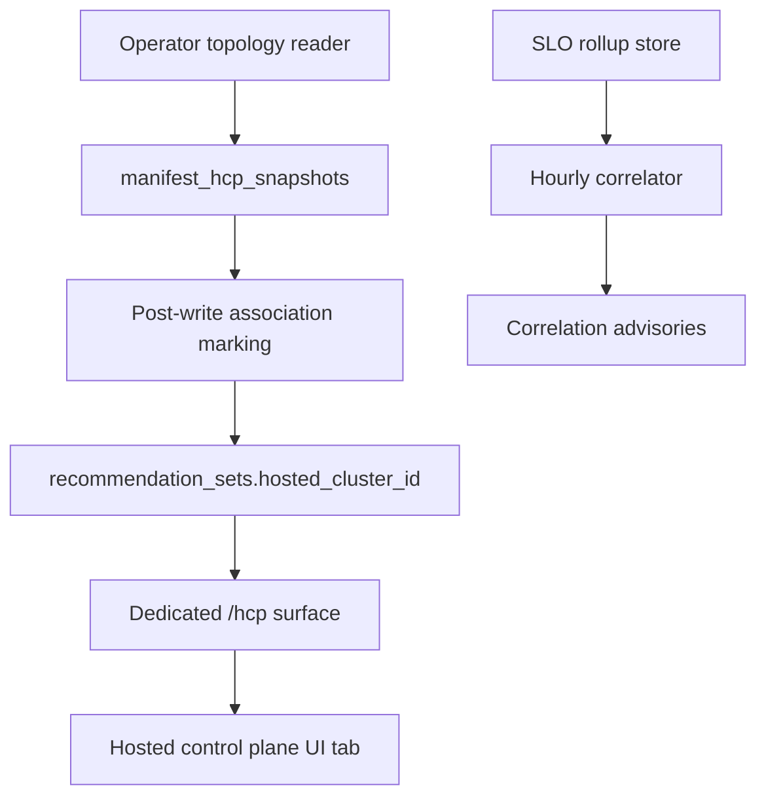

# Hosted Control Plane Recommendations

> **Last verified:** 2026-10-26

!!! success "Status: Shipped"
    Per-hosted-cluster rightsizing for OpenShift HyperShift control planes:
    association, dedicated list/filter/group-by surface, grouped savings,
    UI tab, correlator advisories, and correlator policy settings. Proven live
    on lab SNO + HCP clusters. Remaining fleet work (RH-operated bridge,
    cost distribution, dedicated masters) stays on the
    [planned page](../planned-features/hosted-control-plane-fleet-optimization.md#shipped-vs-remaining).

!!! info "Quick Facts"
    **API:** `GET /api/cost-management/v1/recommendations/openshift/hcp` (list),
    `GET .../hcp/{recommendation-id}` (detail)  
    **Fleet-capacity advisory (implemented; pending integration release):** `GET .../hcp/fleet-capacity` (latest per cluster), `GET .../hcp/fleet-capacity/history?filter[cluster_uuid]=…` (per-cluster trend)
    **Configurable:** Yes (correlator policy via `/settings/hcp-correlation`)  
    **Engines:** cost, performance (both returned on every response)

## Overview

On HyperShift, each hosted cluster's control plane (etcd, kube-apiserver,
konnectivity, …) runs as ordinary pods in a namespace on the *management*
cluster — but `koku-metrics-operator` bills that usage to the management
cluster, hiding which hosted cluster each control-plane watt belongs to.
HCP recommendations attribute control-plane container rightsizing to the
hosted cluster it serves, so platform teams can answer "what does *this*
hosted cluster's control plane cost me" without touching etcd sizing blind.

Out of scope by design: hosted-cluster *sizing* (node counts), hosted
application workloads (those live on the [Container](container-recommendations.md)
tab under their own namespaces), and cost redistribution across hosted
clusters (postponed; association is not an allocation key).

## How it works

1. **Emission** — The operator's topology reader emits namespace→hosted-cluster
   snapshot observations (`manifest_hcp_snapshots`, report-scoped, fail-closed).
   Unknown hosted IDs fail closed with an info log; incomplete windows are omitted.
2. **Association** — A post-write pass stamps `hosted_cluster_id` on rows whose
   namespace is HCP-evidenced (snapshot union clusters-row list), and clears it
   when evidence lapses. Mixed-evidence namespaces stay unassociated rather
   than misattributed.
3. **History** — `recommendation_history` carries the frozen per-row
   association (`''` sentinel = null), so past advice keeps the cluster it was
   computed for.
4. **Serving** — The dedicated surface lists HCP-namespaced container rows:
   associated rows carry the frozen ID, unassociated-but-evidenced rows show
   `incomplete: true`, app-namespace rows never appear (and 404 on detail).
5. **Correlator (advisory-only)** — An hourly job evaluates hosted API pain
   against management-plane stress and writes sweep-expiring advisories; it
   never modifies existing recommendations.

## List, filter, group-by

| Capability | Shape |
|------------|-------|
| `filter[hosted_cluster_id]` | Narrows to one hosted cluster; unknown IDs return 200 with an empty list |
| `filter[scope]=management` | Selects the **management-overhead** scope instead: rows on `cluster_topology = 'management'` clusters whose namespace is not a hosted control plane (absent from `hcp_namespaces`; NULL reads as empty). Keyword-selectable — no other value is accepted (unknown values → 400). Without the param the served shape is unchanged |
| `group_by[hosted_cluster_id]` | One row per hosted cluster: container count plus summed `estimated_savings` (`MoneyAmount` in display currency, `meta.currency` names it) |
| `group_by[namespace]` | One row per namespace under the active scope: container count plus summed `estimated_savings`; combined with `filter[scope]=management` this serves the overhead sub-tab |
| Term/engine projection | Rows carry all six variants; projection is display-side (same as the classic container list) |
| Detail | `GET .../hcp/{id}` — same shape as container detail (native engine JSON: `include=explanation` opt-in, `filter[term]`/`filter[engine]` honored, plots percentile bands); rows the native engine has not written fall back to the synth shape; off-scope IDs 404 under the active scope (a management row 404s without the param and vice versa). Top-level `hosted_cluster_id`, `incomplete` and `management` carry the HCP facts where in scope |

## UI tabs

The **Hosted control plane** optimizations page carries two sub-tabs; the
split between them is the scope selector:

- **Hosted clusters** (default — no scope param): control-plane container rows
  of the hosted clusters. Associated rows carry the hosted cluster they
  serve; an `Incomplete` state marks unassociated-but-evidenced rows (never
  rendered as healthy attribution). Hosted-application workloads never appear
  here — they live on the [Container](container-recommendations.md) tab under
  their own namespaces. Term/engine projection, hosted-cluster filter, and
  group-by with drill-down; detail pages inherit list projection.
- **Management overhead** — the same list with
  `filter[scope]=management&group_by[namespace]`: the management cluster's
  own collected overhead (multicluster-engine, hive, the operator itself)
  aggregated per namespace. The Hosted clusters sub-tab never carries the
  scope selector.

Which management-cluster namespaces make it that far is an explicit
opt-in policy: the `cost_management_optimizations` label must exist on the
namespace object of each management cluster (documentation of a list is not
opt-in; the operator has no default include list — see
[ADR-0342](https://github.com/pgarciaq/ros-ocp-backend/blob/{{ git_branch }}/docs/adr/0342-label-wins-over-namespace-exclusion.md)). The operational
include list and the deliberate exclusions are in the
[data-collection policy](../configuration.md#management-overhead-namespace-label-list-management-clusters).

## Fleet-capacity advisory (W4; implemented, pending integration release)

How many more hosted control planes could the management cluster's eligible
worker set host? Two endpoints answer with the native published-sizing model
(`native_model_version`), with MCE capacity gauges as an optional,
separately-labeled reference:

- **`GET /recommendations/openshift/hcp/fleet-capacity`** — the latest
  snapshot **per authorized management cluster** (the card-list discovery
  surface); `filter[cluster_uuid]` narrows to one cluster.
- **`GET .../fleet-capacity/history?filter[cluster_uuid]=…`** — the
  newest-first per-cluster trend (the cluster filter is required), with
  `limit`/`offset` pagination.

Each row carries five scenarios (`request`, `low_qps`, `average_qps`,
`medium_qps`, `high_qps`) with limiting-resource attribution and serve-time
headroom — **null** when occupancy, worker placement, or average QPS is
unknown, and **withheld** when node pressure is affirmed (an over-committed
cluster must not advertise an exact `+N`). An empty `limiting_resource`
means the scenario has no estimate; absent MCE gauges are null, never zero.
Explicit warnings: `stale` (age over 2× the row's own max cadence),
`below_version_floor` (known OCP under 4.17 — data still served),
`pressured`, `pressure_unknown`, `mce_may_be_stale`, and
`shared_infrastructure` (compact topology: control-plane nodes double as
workers, so estimates may overstate dedicated capacity). Unauthorized or
unknown clusters are non-disclosing (200 with empty data). Design record:
[ADR-0334](https://github.com/pgarciaq/ros-ocp-backend/blob/{{ git_branch }}/docs/adr/0334-fleet-admission-headroom-w4.md)
(amended); status and roadmap on the
[planned-features page](../planned-features/hosted-control-plane-fleet-optimization.md).

## Correlator policy settings

Thin cross-plane policy via **`GET/PUT/DELETE /settings/hcp-correlation`**.
PUT replaces the whole domain (all fields required); values take effect on
the next hourly run (at most one cycle of delay, no recalculation):

| Setting | Default | Env var (locks value) ||---------|---------|----------------------|
| `h_p99_threshold_s` | 0.30 | `ROS_HCP_H_P99_THRESHOLD_S` |
| `h_baseline_multiple` | 3 | `ROS_HCP_H_BASELINE_MULTIPLE` |
| `c_cpu_pct` | 80 | `ROS_HCP_C_CPU_PCT` |
| `c_etcd_p99_s` | 0.01 | `ROS_HCP_C_ETCD_P99_S` |
| `window_h` | 1 | `ROS_HCP_WINDOW_HOURS` |
| `skew_m` | 5 | `ROS_HCP_SKEW_MINUTES` |
| `freshness_h` | 2 (must cover `window_h`) | `ROS_HCP_FRESHNESS_HOURS` |
| `expiry_h` | 24 | `ROS_HCP_EXPIRY_HOURS` |
| `z_idle_req_per_day` | 100 (DEPRECATED — accepted, no longer read; do not tune) | `ROS_HCP_ZOMBIE_IDLE_REQ_PER_DAY` |
| `z_idle_cpu_floor_mc` | 10 (discouraged to tune — see guide) | `ROS_HCP_ZOMBIE_IDLE_CPU_FLOOR_MC` |
| `z_short_window_days` | 3 (pool-zero fast lane; validated ≤ idle window) | `ROS_HCP_ZOMBIE_SHORT_WINDOW_DAYS` |
| `z_short_required_days` | 3 (covered pool-evidence days; validated ≤ short window) | `ROS_HCP_ZOMBIE_SHORT_REQUIRED_DAYS` |
| `z_idle_window_days` | 14 (standard lane; Christmas-docs in guide — shorten with care) | `ROS_HCP_ZOMBIE_IDLE_WINDOW_DAYS` |

Fixed methodological floors (not tunable): 30-minute minimum data per window,
36-hour node-recency calibration. `ROS_SETTINGS_LOCKED_HCP` freezes tenant
overrides under global lock. Full reference:
[configurability](../architecture/configurability.md#hcp-correlation).

## Guardrails

- HCP namespaces keep a control-plane floor profile; no replica
  recommendations for control-plane components.
- The plugin honors `ROS_DISABLED_PLUGINS=hcp` and Kruize mutual exclusivity.
- SLO ingest never permanently fails (skip-with-counters, always `Done`) so a
  poisoned rollup file cannot gate container recommendations.

## Key metrics

| Field | Meaning |
|-------|---------|
| `hosted_cluster_id` | Associated hosted cluster (omitted when empty — never guessed) |
| `management` | `true` when the row's cluster is a management cluster (`clusters.cluster_topology = 'management'`) — a topology fact |
| `incomplete` | `true` when the row's namespace is HCP-evidenced (`hcp_namespaces` member or a complete fresh snapshot) yet its association is missing (empty `hosted_cluster_id`) — a data-quality fact; never fired under `filter[scope]=management` |
| `estimated_savings` (grouped) | Per-HC summed cents rendered as `MoneyAmount` |

### `management` vs `incomplete`

The two flags are independent facts about different things and must never be
read as one state:

| Flag | Question it answers | True when |
|------|--------------------|-----------|
| `management` | *Which kind of cluster does this row run on?* (topology fact) | row's cluster topology is `management` |
| `incomplete` | *Is a hosted association expected but missing?* (data-quality fact) | namespace is HCP-evidenced yet `hosted_cluster_id` is empty |

Documented state space:

- **`management: true`, no `incomplete`** — management-platform namespace
  (multicluster-engine, hive, …): hosted attribution simply does not apply.
  The UI shows the management cluster name (`cluster_alias`), never "—".
- **`management: true` and `incomplete: true` — possible and correct.** HCP
  API pods run as ordinary workloads on the management cluster: such a row
  *runs on a management cluster* (fact 1) *and* its expected hosted
  attribution is missing (fact 2).
- **`management: false`** ⇒ `incomplete` is never set with it today:
  attribution on hosted-topology rows is stamped or the row fails closed
  upstream, so "unassociated" only ever arises on management-topology
  (evidence-carrier) rows.

Design rationale: [HCP per-hosted-cluster design](https://github.com/pgarciaq/ros-ocp-backend/blob/{{ git_branch }}/docs/design/hcp-per-hostedcluster-recommendations.md).
Product decisions: ADRs 0328–0332.
