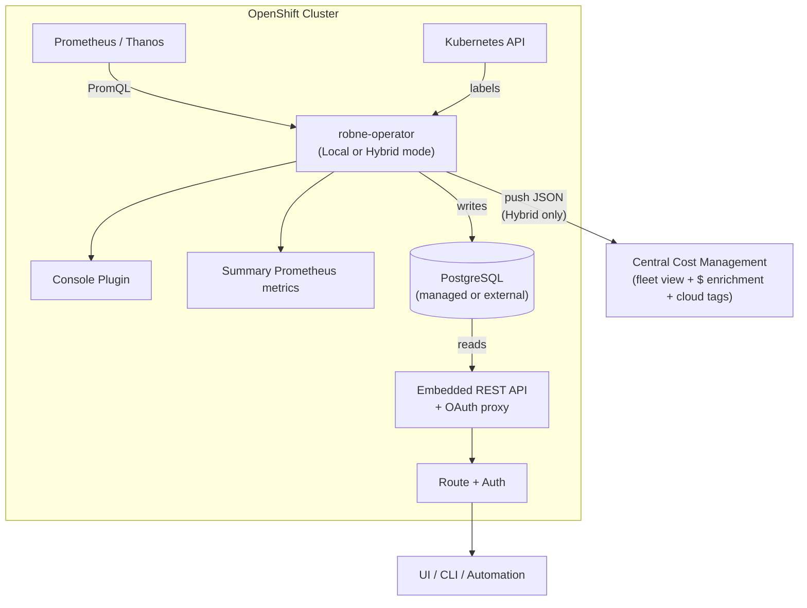

# Resource Optimization for OpenShift — On-Cluster Modes

!!! warning "Status: Planned / Future Work"
    This feature is **not yet implemented**. The description below is the intended
    product direction for a future release. All current recommendation features
    remain available today via the existing remote/upload architecture
    (koku-metrics-operator → central ros-ocp-backend).

!!! info "Quick Facts (planned)"
    **Operator:** Red Hat Lightspeed Resource Optimization Operator (`robne-operator`)  
    **CRD:** `ResourceOptimizationConfig` (`resource-optimization.openshift.io/v1beta1`)  
    **Modes:** Local (on-cluster only), Remote (central compute), Hybrid (both)  
    **Collection frequency:** 15 seconds (Local/Hybrid), 15 minutes (Remote) — configurable  
    **Data source:** Prometheus / Thanos (direct PromQL, no CSV intermediary in Local/Hybrid)  
    **Tags:** Kubernetes labels (real-time) + cloud tags reconciled at central enrichment  
    **Local API:** Embedded REST API (same contract as central ros-ocp-backend)  
    **Storage:** Managed PostgreSQL (~70 MB / 1000 containers; in-cluster or external)  
    **Fleet view:** Hybrid mode pushes recommendations + daily summaries to central Cost Management

Capacity planning at 200K containers (collection vs engine cycle, operator
memory, PostgreSQL PVC): [Scale estimates](#scale-estimates-200k-containers).

---

## What it does

The **Red Hat Lightspeed Resource Optimization Operator** (`robne-operator`) is a
standalone operator — separate from koku-metrics-operator — that delivers Resource
Optimization on OpenShift clusters. It supports three operating modes so customers
can choose the right balance of on-cluster freshness, fleet visibility, and
operational footprint.

| Mode | Engine | Local API | Push to Central | Use case |
|------|--------|-----------|-----------------|----------|
| **Local** | On-cluster | Yes | No | Disconnected, single-cluster, latency-sensitive |
| **Remote** | Central (ros-ocp-backend) | No | CSV metrics (same as koku-metrics-operator today) | Drop-in replacement for koku-metrics-operator ROS |
| **Hybrid** | On-cluster | Yes | Recs + daily summaries (JSON) | Fleet view + local freshness |

In **Local** and **Hybrid** modes, the operator queries Prometheus directly and
computes recommendations on-cluster. Results are written to PostgreSQL and
served through an embedded REST API and OpenShift Console plugin. In **Hybrid**
mode, pre-computed recommendations and persisted daily summaries are also pushed
to central Cost Management for fleet-wide visibility and dollar savings enrichment.

In **Remote** mode, the operator is a lightweight collector and uploader only —
the same role koku-metrics-operator plays for ROS today. Recommendation
computation remains on central ros-ocp-backend.

!!! note "Companion operators"
    Clusters that need both **Cost Management** and **Resource Optimization**
    install both operators: koku-metrics-operator for cost metrics, and
    robne-operator for optimization. They are designed to coexist during the
    migration period.

---

## Why it matters

### Real-time rightsizing

The current pipeline introduces 6–12 hours of end-to-end latency (operator upload
cycle + Koku processing + ROS ingestion). Local and Hybrid modes collect metrics
every **15 seconds** (default) and compute recommendations immediately — VPA-like
responsiveness with the full plugin suite (idle detection, business hours, GPU, etc.).

### Higher data fidelity

Today the operator samples metrics at 15-minute intervals, 4 times per hour
(96 data points per container per day). On-cluster modes sample every 15 seconds
(5,760 data points per container per day) and leverage Prometheus
`quantile_over_time()` and `avg_over_time()` over the full-resolution scrape data —
no sampling loss, 60x more granular than the current architecture.

### Dramatically simpler pipeline

| Current (7 stages) | Local / Hybrid (2 stages) |
|---------------------|---------------------------|
| Prometheus → Operator → CSV → tar.gz → Upload → S3 → Kafka → ROS | Prometheus → robne-operator (engine) → PostgreSQL |

### Works in disconnected environments

Clusters without external connectivity can run **Local** mode and compute
recommendations entirely on-cluster. Dollar savings are unavailable without Cost
Management access, but CPU/memory right-sizing, idle detection, and GPU
classification all function from Prometheus data alone.

### 190x bandwidth reduction (Hybrid mode)

Instead of uploading raw metrics via Remote mode CSV (~190 MB/day for 1000
containers), Hybrid mode pushes only pre-computed recommendation JSON and
compressed daily summary rows (p50/p95/p99/min/max/avg/count per container per
metric, ~1 MB/day). No raw metrics and no t-digest centroids are transmitted.

---

## Architecture overview

### Local and Hybrid modes



### Remote mode


In Remote mode, no engine, database, API, console plugin, or summary metrics are
deployed. The operator collects ROS metrics and uploads CSV payloads — a
drop-in replacement for koku-metrics-operator's ROS functionality.

---

## Operating modes in detail

### Mode-dependent components

| Component | Local | Hybrid | Remote |
|-----------|-------|--------|--------|
| Prometheus collection | Active | Active | Active |
| Recommendation engine | Active | Active | Inactive |
| Managed PostgreSQL | Active | Active | Inactive |
| REST API pod | Configurable (default on) | Configurable (default on) | Unavailable |
| Console Plugin | Configurable (default on) | Configurable (default on) | Unavailable |
| Summary Prometheus metrics | Configurable (default on) | Configurable (default on) | Unavailable |
| CSV packaging + upload | Inactive | Active (JSON format) | Active (CSV format) |

!!! warning "Remote mode restrictions"
    The CRD rejects `spec.api.enabled: true` and `spec.console_plugin.enabled: true`
    when `spec.mode` is `remote`. These components are only available in Local and
    Hybrid modes.

### Switching modes

You can change `spec.mode` at any time:

| Transition | Behavior |
|------------|----------|
| Local → Hybrid | Engine continues; push to central starts |
| Hybrid → Local | Push stops; engine continues |
| Local/Hybrid → Remote | Engine stops; API and plugin torn down; PostgreSQL scaled to 0 (PVC retained) |
| Remote → Local/Hybrid | PostgreSQL provisioned or resumed; engine starts; first recommendations after one cycle |

### Managed PostgreSQL lifecycle

- **Default:** The operator deploys a PostgreSQL StatefulSet, PVC, and Service.
- **External database:** Set `database.type: "external"` and provide a Secret with
  connection details.
- **Switch to Remote:** StatefulSet scaled to 0; PVC retained (default
  `retain_data: true`).
- **Explicit cleanup:** Set `database.managed_config.retain_data: false` to delete
  the StatefulSet and PVC.
- **CR deletion:** All managed resources are garbage-collected via `ownerReference`.

---

## Metric capture frequency

The collection frequency is **mode-dependent** and **user-configurable** via
`spec.collection.interval` in the CRD.

### Defaults by mode

| Parameter | Local | Hybrid | Remote |
|-----------|-------|--------|--------|
| **Collection interval** | 15 seconds | 15 seconds | 15 minutes |
| Configurable range | 15s – 5m | 15s – 5m | 5m – 60m |
| **Engine run interval** | Same as collection (default) | Same as collection (default) | N/A |
| Configurable range | 15s – 5m | 15s – 5m | N/A |
| **Upload cycle** | N/A | 6 hours (min 1h) | 6 hours (min 1h) |

### Why 15 seconds for Local/Hybrid?

In Local and Hybrid modes, the operator computes recommendations on-cluster with
no external bottleneck. The goal is **real-time rightsizing** — recommendations
that track workload behavior within seconds. This enables:

- Burst detection: a workload that spikes has its recommendation updated in 15s
- VPA-like responsiveness without VPA's instability (recommendations inform, not act)
- Immediate visibility into idle/oversized containers after deployment changes

The 15-second default matches the Prometheus scrape interval. Each collection
cycle fires instant PromQL queries plus `quantile_over_time()`, `avg_over_time()`,
and `max_over_time()` aggregations computed server-side by Prometheus. The engine
runs immediately after each collection: percentiles are derived from Prometheus
results, recommendations refreshed, and PostgreSQL updated via upsert (including
persisted daily summary rows).

### Why 15 minutes for Remote?

Remote mode packages CSVs with hourly granularity for upload to central. Higher
frequency would produce enormous files without benefit (central processing is
batch-oriented). The 15-minute default matches koku-metrics-operator's current
behavior.

### Prometheus query load

At 15-second intervals, the operator fires ~20–25 instant queries per cycle
(~100 queries/minute). This is well within Prometheus capacity. The queries use
`rate(...[5m])` windows regardless of collection interval, so they are cheap
vector operations.

For clusters concerned about Prometheus load, configure a longer interval:

| `collection.interval` | Queries/minute | Recommendation freshness |
|----------------------|----------------|--------------------------|
| `15s` (default Local/Hybrid) | ~100 | ≤ 15 seconds |
| `60s` | ~25 | ≤ 1 minute |
| `5m` | ~5 | ≤ 5 minutes |
| `15m` (default Remote) | ~2 | ≤ 15 minutes |

### Decoupling collection from engine

By default, the engine runs after every collection cycle. For CPU-constrained
environments, you can decouple them:

```yaml
spec:
  collection:
    interval: "15s"     # collect frequently
  engine:
    recommendation_cycle: "60s"  # but compute recommendations less often
```

This still queries Prometheus at 15-second resolution, but the engine plugins
(percentile extraction, idle classification, recommendation generation) only execute
once per minute.

### Prometheus-side aggregation

Percentile and aggregate computation is delegated to Prometheus — the operator
does not maintain in-memory t-digests:

- **Instant queries** per collection cycle: `rate(...[5m])` for current usage
- **Range aggregations** via PromQL: `quantile_over_time()`, `avg_over_time()`,
  `max_over_time()` over the recommendation window
- **Daily summaries persisted** to PostgreSQL: p50/p95/p99/min/max/avg/count per
  container per metric per day (~70 bytes per row)
- **No operator-side digest state**: pod restarts do not lose statistical history;
  Prometheus retention + persisted daily summaries provide long-term accuracy

At 15s collection intervals, Prometheus retains full-resolution scrape data.
The operator stores only the daily summary rows it needs for recommendations and
Hybrid push — not raw samples and not t-digest centroids.

---

## How it works

### On-cluster computation (Local / Hybrid)

1. Operator fires instant PromQL queries plus range aggregations against
   Prometheus/Thanos (results consumed directly instead of written to CSV)
2. Prometheus computes statistics server-side:
   `quantile_over_time()`, `avg_over_time()`, `max_over_time()`
3. Engine plugins apply decay weighting and recommendation logic
   (same algorithms as central ros-ocp-backend)
4. PostgreSQL upsert: recommendations + persisted daily summary rows
   (p50/p95/p99/min/max/avg/count per container per metric)
5. **Hybrid only:** Pre-computed recommendations and daily summaries pushed to
   central Cost Management as compressed JSON tar.gz (not raw metrics, not
   t-digest centroids)

### Design decisions: percentile computation

**Chosen approach (Option C): Prometheus-side aggregation with persisted daily
summaries.** The operator delegates statistical computation to Prometheus via
`quantile_over_time()`, `avg_over_time()`, `max_over_time()`. It persists daily
summary rows to PostgreSQL and pushes those summaries (plus recommendations) in
Hybrid mode.

| Alternative | Why rejected |
|-------------|--------------|
| **A — Operator-maintained t-digests** | Duplicates Prometheus; complex state management (pod restarts lose in-memory digests); ~60 MB memory overhead; overkill for central push needs |
| **B — Fully stateless, no persistence** | Prometheus retention (default 15d) limits long-term accuracy; no meaningful Hybrid push payload; heavy burst load at push time; pod restart = cold start |

### Local data access

Three ways to consume on-cluster recommendations:

| Access path | Description |
|-------------|-------------|
| **REST API** | Embedded in the operator binary; same contract as central ros-ocp-backend. OAuth proxy auth by default (`oc login` credentials) or JWT (Keycloak/RHBK). |
| **Console Plugin** | Ships with the operator; provides recommendations in the OpenShift Console. |
| **Summary metrics** | Alerting-focused Prometheus gauges (not per-container detail). See [Summary metrics](#summary-prometheus-metrics) below. |

Per-container detail is available through the REST API, not through Prometheus metrics.

### Central enrichment (Hybrid mode)

1. Receives lightweight recommendation JSON and daily summary rows (not raw
   metrics, not t-digest centroids)
2. Enriches with dollar savings using cost model rates
3. Reconciles tags: applies enabled/disabled policy, resolves tag mappings, and
   re-associates cloud tags via OCP-on-cloud correlation
4. Stores in the fleet-wide recommendation database
5. UI displays aggregated view across all clusters

Central can also re-compute recommendations with different parameters (fleet-wide
business hours, tag policies) using the pushed daily summaries.

---

## Tag and label reconciliation

On-cluster recommendations carry raw Kubernetes labels from the cluster. When
pushed to central Cost Management (Hybrid mode), full tag functionality is
preserved through the enrichment step:

### OCP labels (real-time on-cluster)

The operator reads pod and namespace labels directly from the Kubernetes API —
no delay, no sampling. All labels are pushed with each recommendation.
Central applies the **enabled/disabled** tag policy at query time, so only
approved tag keys appear in API responses.

### Tag mappings (resolved centrally)

If an organization maps `ocp:app` to `aws:Application`, the central system
resolves this during enrichment. A recommendation carrying `app=frontend` becomes
filterable by both `filter[tag:app]=frontend` and `filter[tag:Application]=frontend`.
The same tag-mapping mechanism used today applies unchanged.

### Cloud tags (re-associated via OCP-on-cloud correlation)

Cloud provider tags (AWS tags, Azure tags, GCP labels) that exist only on
infrastructure resources are re-associated with recommendations at central.
This uses the existing OCP-on-cloud correlation data (pod → node → cloud
instance → cloud tags) that is already computed for cost attribution.

This requires cloud billing integration to be active — which it already is
for any customer needing dollar savings (the `effective_rates` endpoint
requires cost model rates + cloud costs).

### Disconnected clusters (Local mode)

Bare-metal and air-gapped clusters have no cloud tags by definition. Local mode
is fully self-contained for tag filtering using Kubernetes labels alone.

---

## Summary Prometheus metrics

Summary gauges are exposed for alerting and dashboards. Per-container recommendations
are available only through the REST API.

```
robne_idle_containers_total{cluster, namespace}
robne_oversized_containers_total{cluster, namespace}
robne_undersized_containers_total{cluster, namespace}
robne_optimal_containers_total{cluster, namespace}
robne_estimated_monthly_savings_usd{cluster}
robne_stale_recommendations_total{cluster}
robne_recommendation_freshness_seconds{cluster}
robne_idle_nodes_total{cluster}
robne_consolidation_candidates_total{cluster}
robne_recommendation_cycles_total{cluster}
robne_recommendation_errors_total{cluster, plugin}
```

---

## Key differences from current architecture

| Aspect | Current (koku-metrics-operator + central) | Local / Hybrid (robne-operator) |
|--------|------------------------------------------|--------------------------------|
| Operator | koku-metrics-operator (ROS CSV upload) | robne-operator (standalone) |
| Collection frequency | Every 15 minutes (instant queries) | Every 15 seconds (configurable 15s–5m) |
| Recommendation freshness | 6–12 hours | ≤ 15 seconds (configurable) |
| Data fidelity | 96 samples/day | 5,760 samples/day (full Prometheus resolution) |
| On-cluster footprint (Remote) | ~50 Mi (collector only) | ~50 Mi (collector only) |
| On-cluster footprint (Local/Hybrid) | N/A | ~200 Mi (operator + engine + DB) |
| PostgreSQL | Central only | Dedicated (managed or external) |
| Storage per 1000 containers | ~20 GiB (central, digests+samples) | ~70 MB (recs + daily summaries) |
| Local API access | No (central API only) | Yes (embedded REST API) |
| Console plugin | No | Yes (configurable) |
| OCP labels | Synced from Koku (hours delay) | Kubernetes API (real-time) |
| Cloud tags | Native (central correlates) | Re-associated at central enrichment |
| Tag mappings | Applied centrally | Applied centrally (same mechanism) |
| Disconnected support | No | Yes (Local mode; minus dollar savings and cloud tags) |
| Fleet visibility | Native (central computes) | Hybrid push to central |
| Dollar savings | Always available | Available after central enrichment, or optional `effective_rates` fetch |

---

## Who benefits

- **Disconnected / air-gapped clusters** — Local mode without external upload
- **Latency-sensitive environments** — minute-level freshness
- **Single-cluster customers** — no need for full Kafka + S3 + remote ROS stack
- **Bandwidth-constrained environments** — 190x reduction in upload size vs. Remote CSV (Hybrid)
- **RHACM users** — Thanos provides unlimited lookback for long-term recommendations
- **Existing ROS customers** — Remote mode as a drop-in koku-metrics-operator replacement

---

## Planned CRD configuration

```yaml
apiVersion: resource-optimization.openshift.io/v1beta1
kind: ResourceOptimizationConfig
metadata:
  name: resourceoptimizationcfg
spec:
  mode: "hybrid"   # "local", "remote", or "hybrid"
  prometheus_config:
    service_address: "https://thanos-querier.openshift-monitoring.svc:9091"
    context_timeout: 120
    collect_previous_data: true
  collection:
    interval: ""   # auto: 15s for local/hybrid, 15m for remote
  engine:
    recommendation_cycle: ""   # auto: same as collection.interval
    plugins:
      container: {enabled: true}
      namespace: {enabled: true}
      node: {enabled: true}
      vm: {enabled: true}
      pvc: {enabled: true}
      quota: {enabled: true}
      cluster_quota: {enabled: true}
      gpu: {enabled: true}
      snapshot: {enabled: true}
    idle_detection: {enabled: true}
    business_hours: {enabled: true}
    savings_estimation: {enabled: true}
  database:
    type: "managed"
    managed_config:
      storage_size: "1Gi"
      retain_data: true
  api:
    enabled: true
    route: true
    auth:
      type: "oauth-proxy"   # or "jwt"
  console_plugin:
    enabled: true
  central:
    api_url: "https://console.redhat.com"
    authentication:
      type: "token"         # or "service-account"
    upload:
      upload_cycle: 360
      upload_toggle: true
    effective_rates:
      enabled: false        # optional on-cluster dollar savings
  source:
    name: ""
    create_source: false
  volume_claim_template:
    spec:
      accessModes: ["ReadWriteOnce"]
      resources:
        requests:
          storage: "10Gi"
```

### Plugins and features

All plugins are enabled by default. Each can be disabled individually via
`spec.engine.plugins.<name>.enabled: false`:

`container`, `namespace`, `node`, `vm`, `pvc`, `quota`, `cluster_quota`, `gpu`, `snapshot`

Additional engine features: `idle_detection`, `business_hours`, `savings_estimation`.

### Authentication

| Path | Mechanism | Notes |
|------|-----------|-------|
| Local API | OAuth proxy (default) | Uses OpenShift OAuth; `oc login` credentials |
| Local API | JWT | Keycloak / RHBK tokens |
| Central connection | Token | From pull-secret (same as koku-metrics-operator) |
| Central connection | Service account | `client_credentials` flow |

### Dollar savings in Local mode

Cost and performance engines differ only in thresholds. Without `effective_rates`,
dollar values are unavailable but all sizing recommendations still work. Optionally
configure `spec.central.effective_rates.enabled: true` to fetch rates from a Cost
Management instance (same auth as the central connection).

When `spec.api.enabled` or `spec.console_plugin.enabled` is `false`, recommendations
are still written to PostgreSQL and accessible via direct database queries or
summary Prometheus metrics.

---

## Migration from koku-metrics-operator

| Phase | Change |
|-------|--------|
| **Phase 1** | robne-operator ships alongside koku-metrics-operator (overlap period) |
| **Phase 2** | koku-metrics-operator removes ROS queries in a future version |
| **Phase 3** | koku-metrics-operator documentation references robne-operator for Resource Optimization |

!!! info "OLM dependency"
    The relationship between operators is documented but **not declared as an OLM
    dependency**, to avoid installation friction for customers who install only one
    operator.

For existing deployments, set `spec.mode: "remote"` on robne-operator to replicate
current koku-metrics-operator ROS behavior, then migrate to Hybrid or Local when
ready.

---

## Prometheus requirements

- Standard OpenShift monitoring stack (Prometheus or Thanos via RHACM)
- Same RBAC patterns as koku-metrics-operator (no additional permissions beyond
  what each mode requires)
- Prometheus retention affects long-term recommendations:
  - 15-day retention: short and medium terms fully supported; long term degraded
  - With Thanos (RHACM): unlimited lookback, all terms fully supported
  - Graceful degradation: terms with insufficient data report lower confidence

---

## Business hours and reship

In the current (Remote / koku-metrics-operator) architecture, changing a business-hours
schedule triggers a **reship**: Koku re-publishes historical ROS CSV files from S3 to
Kafka so that ros-ocp-backend can re-ingest them with the new time-of-day
weighting applied. This works because raw CSVs persist in S3 for ~90 days.

Local and Hybrid modes eliminate the reship mechanism entirely. Instead:

**With Thanos (RHACM):** The operator re-queries Thanos for the full
recommendation window with the new business-hours weighting. Thanos has
unlimited retention, so retroactive re-computation is immediate and complete.
This is strictly superior to the CSV reship approach (faster, higher fidelity,
no S3/Kafka dependency).

**With Prometheus only (~15-day retention):** The operator re-queries Prometheus
for whatever data is within retention. For data beyond the retention window,
the new schedule takes effect **forward-only** — old recommendations gradually
age out as the sliding window advances. After N days (where N = Prometheus
retention), the recommendation window is fully converged to the new schedule.

| Scenario | Retroactive BH re-computation |
|----------|-------------------------------|
| Thanos (RHACM) | Immediate and complete (unlimited lookback) |
| Prometheus only (15d retention) | Last 15 days immediate; older days converge forward-only over 15 days |
| Current architecture (reship) | Full retroactive via S3 CSV re-ingestion (up to 90 days) |

Since business-hours schedules change infrequently (typically once per quarter),
the forward-only convergence period is acceptable for Prometheus-only
deployments. Customers requiring instant retroactive BH re-computation across
the full window should use Thanos via RHACM.

!!! note "Daily summaries and business hours"
    Persisted daily summary rows (p50/p95/p99/min/max/avg/count per container per
    metric) already support retroactive BH re-computation for data within the
    summary retention window. With Thanos, the operator can also re-query
    Prometheus directly for full-window retroactive re-computation.

---

## Limitations (planned)

- Dollar savings require connectivity to central Cost Management, or optional
  `effective_rates` API access for on-cluster computation
- Cloud tags on recommendations require cloud billing integration to be active
  at central (already required for dollar savings); disconnected clusters have
  OCP labels only
- Cloud tag association may lag by up to 24 hours for newly provisioned nodes
  (same latency as the current architecture — CUR/export data is not real-time)
- Business-hours schedule changes on Prometheus-only clusters (no Thanos) take
  effect forward-only; full convergence after the Prometheus retention period
  (typically 15 days)
- Boxplot API queries Prometheus at request time (not pre-stored)
- Fleet-wide view requires Hybrid mode with the push-to-central path configured
  and reachable
- Remote mode does not expose a local API, console plugin, or summary metrics

## Scale estimates (200K+ containers)

!!! info "Scope and provenance"
    Estimates for the planned Local Mode operator at the 200K-container target,
    based on profiling the ros-ocp-backend engine and PostgreSQL write
    throughput benchmarks. The librobne extraction itself is complete
    (ADR-0303, shipped): how to call the library is
    [Integrating librobne](../architecture/librobne.md); extract performance
    gates live in
    [`docs/performance/librobne-baseline-841639f3/`](https://github.com/pgarciaq/ros-ocp-backend/blob/{{ git_branch }}/docs/performance/librobne-baseline-841639f3/README.md),
    not in the estimates below.

### Context

The robne-operator (Local Mode) embeds the librobne recommendation engine
on-cluster. Unlike ros-ocp-backend, which processes batch CSV uploads every
6–12 hours, the operator queries Prometheus at configurable intervals (15s–5m)
and runs the engine on fresh data. At large cluster scale (200K containers),
both the collection cycle (Prometheus queries + daily summary upserts) and the
engine cycle (librobne computation + recommendation writes) must complete within
their respective intervals.

This analysis quantifies the feasibility boundaries and recommends default
settings.

---

### Collection Cycle: Prometheus Queries + Daily Summary Upserts

Each collection cycle queries Prometheus for current metrics and upserts daily
summary rows into PostgreSQL. At 200K containers, the upsert volume is the
bottleneck — Prometheus vectorized queries (`quantile_over_time`) return all
containers in a single response.

**Upsert rate by collection interval:**

| Collection interval | Upserts/cycle | Upserts/second | PostgreSQL load | Feasibility |
|---------------------|---------------|----------------|-----------------|-------------|
| 15s | 200,000 | ~13,300 | Very heavy | Feasible but tight |
| 60s | 200,000 | ~3,300 | Comfortable | Recommended |
| 120s | 200,000 | ~1,700 | Very comfortable | Conservative |
| 300s | 200,000 | ~670 | Light | Over-conservative |

At 60s intervals, PostgreSQL must sustain ~3,300 upserts/second. With batched
`INSERT ... ON CONFLICT DO UPDATE` (2000-row batches, matching
[ADR-0093](https://github.com/pgarciaq/ros-ocp-backend/blob/{{ git_branch }}/docs/adr/0093-chunked-pgx-batches-500.md)), this requires
~1.7 batch executions per second — well within single-connection PostgreSQL
throughput on modern hardware.

At 15s intervals, 13,300 upserts/second is achievable with connection pooling
and parallel batch writers, but leaves minimal headroom for query spikes or
garbage collection pauses.

---

### Engine Cycle: librobne Computation + Recommendation Writes

The engine cycle reads daily summary rows, calls librobne per-entity functions,
and writes recommendations to PostgreSQL.

#### Compute time

librobne functions are pure CPU-bound computation with no I/O. Profiling the
current ros-ocp-backend engine on representative data:

| Entity | Calls at 200K | CPU time | Notes |
|--------|---------------|----------|-------|
| Container | 200K x 3 terms x 2 engines = 1.2M | ~6–12s | Decay weighting + percentile computation |
| Namespace | ~10K namespaces | <1s | Aggregation over container results |
| Node | ~500 nodes x 3 terms x 2 engines | <1s | Allocatable vs capacity ratios |
| GPU | ~2K GPUs (if present) | <1s | Multi-metric tree classification |
| PVC | ~20K PVCs | <1s | Regression + trend projection |
| Quota | ~10K namespace quotas | <1s | Headroom + risk band computation |
| Cluster Quota | ~100 CRQs | <1s | Namespace rollup |
| VM | ~5K VMs (if present) | ~1–2s | Instance catalog matching |
| Snapshot | ~10K snapshots | <1s | Priority-ordered classification |
| **Total compute** | | **~10–18s** | |

Container recommendations dominate at 200K scale. The 1.2M calls
(200K containers x 3 terms x 2 engines) each involve weighted percentile
computation over 14-day digest windows — the most expensive per-call operation
in the engine.

#### Write time

After computation, 1.2M recommendation rows must be upserted to PostgreSQL:

| Batch size | Batches | Time (estimated) | Notes |
|------------|---------|------------------|-------|
| 500 rows | 2,400 | ~10–30s | Depends on index count and disk I/O |
| 1,000 rows | 1,200 | ~8–20s | Larger batches reduce round-trip overhead |

#### Total engine cycle time

| Component | Time |
|-----------|------|
| Read daily summaries | ~2–5s |
| librobne computation | ~10–18s |
| Write recommendations | ~10–30s |
| **Total** | **~25–50s** |

---

### Constraint Matrix

The collection interval and engine interval can be configured independently.
The collection cycle feeds daily summary rows; the engine cycle reads them and
produces recommendations. Multiple collection cycles between engine runs refine
today's summary row (incremental aggregation).

| Collection | Engine | Prometheus load | PG write load | Recommendation freshness | Feasible? |
|------------|--------|-----------------|---------------|--------------------------|-----------|
| 15s | 15s | Very heavy | Very heavy | 15s | **No** — engine cannot finish in 15s |
| 15s | 60s | Very heavy | Heavy | 60s | Tight — collection load dominates |
| 60s | 60s | Moderate | Tight | 60s | Tight — engine takes 25–50s, leaving <10s margin |
| 60s | 300s | Moderate | Comfortable | 5 min | **Yes — recommended** |
| 120s | 300s | Light | Very comfortable | 5 min | Yes — conservative |
| 120s | 600s | Light | Light | 10 min | Yes — for resource-constrained clusters |
| 300s | 900s | Very light | Very light | 15 min | Yes — minimal resource overhead |

**Recommended default at 200K containers:** collection 60s, engine 300s (5 min).

This provides:

- 60-second Prometheus query resolution (sufficient for rightsizing trends)
- 5-minute recommendation freshness (adequate for sizing decisions)
- Comfortable PostgreSQL write budget (~25–50s compute + write within 300s window)
- ~20% CPU duty cycle (active for ~1 minute out of every 5)

---

### Resource Requirements at 200K Containers

#### Operator pod

| Resource | Estimate | Rationale |
|----------|----------|-----------|
| Memory | 512 MiB – 1 GiB | 200K containers x 14 days x ~70 bytes/digest = ~200 MB digest data in memory during engine run. Plus Go runtime, Prometheus client buffers, and recommendation result buffers. |
| CPU | 200m average, 1–2 cores burst | ~20% duty cycle at 60s/300s settings. Burst during engine computation phase. |

#### PostgreSQL

| Resource | Estimate | Rationale |
|----------|----------|-----------|
| PVC size | 2–5 GiB | 1.2M recommendation rows (~400 bytes each) = ~480 MB. Daily summary rows (200K x 14 days x ~100 bytes) = ~280 MB. Plus indexes, WAL, and headroom. |
| Memory | 256–512 MiB | Shared buffers for recommendation and digest table indexes. |
| CPU | 200m average | Dominated by upsert batches during collection and engine cycles. |

#### Prometheus impact

At 60-second collection intervals, the operator fires ~30–40 vectorized PromQL
queries per cycle. Each query returns all matching containers in a single
response (instant vector). Prometheus resource impact:

| Metric | Impact |
|--------|--------|
| Query rate | ~0.5–0.7 queries/second |
| Memory | Minimal incremental (queries use existing TSDB blocks) |
| CPU | Low (vectorized queries are efficient in Prometheus) |

The queries use `quantile_over_time()`, `avg_over_time()`, and
`max_over_time()` with `rate(...[5m])` inner windows — all computed server-side
by Prometheus without transmitting raw samples.

---

### What Would Break at 200K

These are the components that require explicit configuration or sizing changes
when scaling to 200K containers:

1. **Operator memory.** Default ~200 MiB is insufficient. The engine loads all
   digest data for the active window into memory during computation. At 200K
   containers with 14-day lookback, this requires 512 MiB–1 GiB. CRD resource
   limits must be increased, or the operator should auto-detect and request
   appropriate limits.

2. **Recommendation table size.** 1.2M rows with proper indexes for API queries
   (keyset pagination, tag filtering, namespace/cluster scoping) generates
   significant index overhead. Without appropriate indexes, list queries degrade
   from sub-100ms to multi-second. The managed PostgreSQL must create the same
   composite indexes used by ros-ocp-backend.

3. **PostgreSQL PVC size.** Default 1 GiB is insufficient for 200K containers.
   Recommendation rows + daily summaries + indexes + WAL requires 2–5 GiB.
   The CRD `spec.database.managed_config.storage_size` must be increased.

4. **Engine cycle interval.** Cannot be set below ~60 seconds at 200K scale
   (engine computation alone takes 25–50s). The 15-second default appropriate
   for small clusters must be overridden. CRD validation should warn when
   `engine.recommendation_cycle` is less than an estimated minimum based on
   container count.

5. **Connection pool sizing.** Default PostgreSQL `max_connections` (100) is
   sufficient for the operator's single-connection batch writer, but if the
   embedded API serves concurrent requests during engine write phases,
   connection contention can stall upserts. Recommend dedicated connections for
   the engine writer path.

---

### Decoupling Collection from Engine

The key architectural insight enabling scalability is that collection and engine
cycles are fully independent:

```
Collection cycle (every 60s):
  1. Query Prometheus (vectorized — all containers in one response)
  2. Upsert daily summary rows (incremental aggregation)

Engine cycle (every 300s):
  1. Read daily summary rows for active window
  2. Call librobne functions (pure CPU computation)
  3. Write recommendation rows
```

**Daily summary rows serve as the buffer** between collection and engine —
no in-memory queue is needed. Prometheus computes `quantile_over_time()`
server-side; the operator persists the results. Between engine runs, multiple
collection cycles refine today's summary row (running p50/p95/p99/min/max/avg
are updated in-place via SQL aggregation).

This decoupling means:

- Collection can run at high frequency (60s) without triggering engine
  computation each time.
- Engine can run at lower frequency (300s) without missing data — all collection
  results are persisted in daily summary rows.
- If the engine falls behind (takes >300s), the next run processes accumulated
  daily summary data without loss. The system degrades gracefully to longer
  recommendation freshness rather than dropping data.
- Pod restarts do not lose statistical history — daily summary rows persist in
  PostgreSQL.

---

### Scaling Beyond 200K

At 500K+ containers, additional measures become necessary:

| Scale | Bottleneck | Mitigation |
|-------|-----------|------------|
| 500K | Engine compute time (~60–120s) | Parallel per-namespace computation; engine interval 600s+ |
| 500K | PG write throughput | Multiple writer goroutines with connection pooling |
| 1M | Prometheus query latency | Thanos federation; per-namespace query sharding |
| 1M | Operator memory (~2–4 GiB) | Streaming computation (process one namespace at a time, flush, continue) |
| 1M | Recommendation table (6M rows) | Table partitioning by namespace hash or date |

These mitigations are not needed at the 200K target scale and are documented
here for future reference only.

---

### Write Optimization: COPY FROM for Large-Scale Deployments

At 200K containers, the engine cycle writes ~1.2M recommendation rows per run.
With standard upsert (`INSERT ... ON CONFLICT DO UPDATE`), this takes ~10–30
seconds depending on index count and disk I/O. PostgreSQL `COPY FROM` with a
staging table pattern can reduce write time significantly.

#### Staging table pattern

1. `CREATE TEMP TABLE staging (...)` — matching the `recommendation_sets` schema
2. `COPY FROM` binary into staging (~1–3 seconds for 1.2M rows)
3. `INSERT INTO recommendation_sets SELECT FROM staging ON CONFLICT DO UPDATE`
   (~5–10 seconds)
4. Temp table dropped on commit

Total write time drops from ~10–30 seconds (batched upsert) to ~6–13 seconds
(COPY + upsert from staging).

#### Why this fits the operator model

The `COPY FROM` approach is particularly effective for the robne-operator because:

- **Full reconcile per engine cycle.** Each engine run produces a complete set of
  recommendations (not incremental deltas like ros-ocp-backend's per-manifest
  ingestion). The entire result set can be staged and upserted in one pass.
- **Sole writer.** The operator is the only writer to its managed PostgreSQL
  instance — no concurrent producer contention or lock conflicts on the
  `recommendation_sets` table during the COPY phase.
- **Operator-controlled connection pool.** No shared pool pressure from other
  services. The engine writer can hold a connection for the full COPY + upsert
  duration without starving API queries.

#### When to use COPY FROM

**Recommended threshold:** consider `COPY FROM` when container count exceeds 50K
(>300K recommendation rows per engine cycle). Below that threshold, the standard
`pgx.Batch` upsert path (2000-row batches per
[ADR-0093](https://github.com/pgarciaq/ros-ocp-backend/blob/{{ git_branch }}/docs/adr/0093-chunked-pgx-batches-500.md)) completes in under
5 seconds and adds no implementation complexity.

**Not needed for ros-ocp-backend's current ingestion path**, where per-manifest
batch sizes are moderate and `pgx.Batch` is sufficient.

#### robne CLI

The standalone `robne` CLI has shipped (Phases 1–3, including HCP
fleet-capacity); it uses the standard `pgx.Batch` upsert path, not `COPY FROM`.
A future optimization could adopt `COPY FROM` on the CLI's owned database (no
concurrent writers, clean lifecycle — staging can be skipped), but no such
work is planned or greenlit.

---

### Related

- [ADR-0303: Library Extraction of the Native Engine](https://github.com/pgarciaq/ros-ocp-backend/blob/{{ git_branch }}/docs/adr/0303-library-extraction-librobne.md)
- [ADR-0287: Operator 14-day Prometheus lookback](https://github.com/pgarciaq/ros-ocp-backend/blob/{{ git_branch }}/docs/adr/0287-operator-14-day-prometheus-lookback-integration-boundary.md)
- [ADR-0093: Chunked pgx batches](https://github.com/pgarciaq/ros-ocp-backend/blob/{{ git_branch }}/docs/adr/0093-chunked-pgx-batches-500.md)
- [ADR-0295: Integer-first architecture](https://github.com/pgarciaq/ros-ocp-backend/blob/{{ git_branch }}/docs/adr/0295-integer-first-architecture.md)
