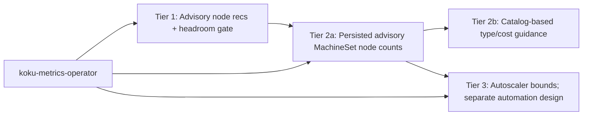
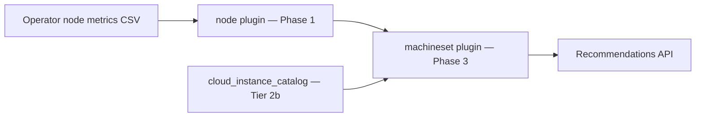

# MachineSet Recommendations (Tier 2)

!!! warning "Status: Planned / Future Work"
    Tier 1 **aggregation** at `GET .../machinesets` is **shipped**. Tier 2a
    (advisory node-count target, persistence, detail/history, notifications) is
    **specified; implementation is blocked on KMO MachineSet API snapshot,
    RBAC, and coverage reporting**. Tier 2b (instance type from cloud catalog)
    is independent and remains blocked on catalog integration.

!!! info "Quick Facts"
    **Scope:** OpenShift MachineSet node-count and instance-type recommendations (currently supported scope: IPI clusters)<br>
    **Plugin:** `machineset` (Phase 3 Optimize)  
    **Shipped today:** `GET /api/cost-management/v1/recommendations/openshift/machinesets` (Tier 1 aggregation)  
    **Tier 2a (next):** Advisory node-count targets, persisted recommendations, detail/history, planned notification IDs 88–90<br>
    **Tier 2b (later):** Instance family/size from cloud catalog (REQ-8c.6)  
    **Internal spec:** [machineset-recommendations.md](https://github.com/pgarciaq/ros-ocp-backend/blob/{{ git_branch }}/docs/features/machineset-recommendations.md)

**Related:** [Node consolidation (Tier 1)](../features/node-recommendations.md), [REQ-8c in requirements.md](../architecture/requirements.md), [notification codes](../architecture/notification-codes.md) (codes 14, 16–17 reserved for Tier 3)

---

## Tier overview

Three tiers add different recommendation capabilities. **All ROS recommendations
remain advisory and require human review; none automatically changes a
MachineSet.**

| Tier | Status | Purpose | Automation posture | Primary API |
|------|--------|---------|-------------------|-------------|
| **1** | **Shipped** | Per-node classification, sizing, **advisory** fleet consolidation | **Human review required** — no PDB/scheduling simulation | `GET .../recommendations/openshift/nodes` |
| **2a** | Planned (partial: machinesets list) | Advisory MachineSet node-count targets, persistence, detail/history, notifications | **Human review required** — no PDB/placement simulation or auto-apply | `GET .../recommendations/openshift/machinesets` |
| **2b** | Planned | Catalog-driven instance-family/size and cost comparison | Advisory; human review required | Extension of `GET .../recommendations/openshift/machinesets` |
| **3** | Planned | MachineAutoscaler min/max and scaling behavior | Future, separately designed capability | Extension of machinesets API or dedicated endpoint |

| Tier | Actionable unit | Est. remaining effort |
|------|-----------------|----------------------|
| **1** | Individual node (+ fleet grouping for advisory `node_count_reduction`) | — |
| **2a/2b** | MachineSet | Previously estimated together; estimates need refresh against the KMO snapshot/RBAC dependency and split scope |
| **3** | MachineSet + MachineAutoscaler | **~4–6 weeks** after Tier 2 |

### Tier 1 — Advisory consolidation with safety gates (shipped)

- **Advisory only:** `node_count_reduction` and fleet sums are FinOps signals for platform review, not drain/scale commands.
- **Safety gates today:** `pod_scheduling_headroom` vs `pod_headroom_consolidation_gate` suppresses consolidation on nodes with little spare pod capacity; idle/zombie and performance-engine headroom multipliers add further guards.
- **Does not include:** PDB checks, scheduling simulation, or MachineSet replica metrics from the operator.
- **Industry alignment:** Same advisory model as AWS Compute Optimizer, Kubecost, and CAST AI (recommendations without automated apply).

See [Node consolidation (Tier 1)](../features/node-recommendations.md#fleet-consolidation-advisory-only-tier-1) for full Tier 1 behavior.

### Tier 2a — Advisory MachineSet node-count recommendations

- **Goal:** Persist a customer-requested target for the number of Machine/node instances managed by each eligible MachineSet, with detail, history, confidence, and notifications.
- **Engine:** Reuse the existing MachineSet-first `node_count_reduction` model and pod-headroom gate. This is advisory; it does not simulate scheduler placement or guarantee PDB compliance.
- **Data gate:** Require a fresh MachineSet API snapshot and complete, fresh node-recommendation coverage. Withhold a target when Machine API reads fail, counts disagree, or any member lacks eligible data. Expose per-cluster collection state in list metadata so empty results distinguish no recommendation from unsupported/incomplete data.
- **KMO dependency:** Collect MachineSet desired/status counts through the API and grant read-only `list` for `machines` and `machinesets` in both RBAC source and OLM permissions.
- **Outcome:** Human-reviewed node-count guidance. It is not “safe to apply” and ROS does not apply changes.

### Separate research: PDB and placement feasibility

PDB eviction feasibility and scheduler placement (affinity/anti-affinity and
related constraints) are not Tier 2a requirements. Their feasibility and data
requirements are being investigated separately in [#709](https://github.com/pgarciaq/ros-ocp-backend/issues/709)
and [#710](https://github.com/pgarciaq/ros-ocp-backend/issues/710). These
investigations do not commit ROS to a simulator or automated action.

### Tier 3 — Autoscaler integration (“autonomous scaling”)

- **Goal:** Tune **MachineAutoscaler** `minReplicas` / `maxReplicas` (and optionally policy hints) from historical replica vs utilization time series.
- **Depends on:** Tier 2 MachineSet identity and historical MachineSet API snapshots (desired/observed/available counts), plus MachineAutoscaler bounds/state.
- **Outcome:** Bound recommendations and saturation/idle/flapping notifications suitable for policy-driven or semi-autonomous scaling — highest risk; conservative heuristics and manual-review messaging expected first.

See [Autoscaler optimization](autoscaler-optimization.md) for Tier 3 design.



---

## What Tier 2 will do

MachineSet recommendations move fleet optimization from per-node signals to
**MachineSet-level node-count guidance** — the unit cluster admins change in
supported IPI-provisioned OpenShift environments.

> In a MachineSet, `.spec.replicas` is the desired number of **Machine objects
> that become cluster nodes**. It does not mean replicas of an application Pod.
> ROS presents the recommendation as a desired **node count** (for example,
> “set this MachineSet to 3 nodes”).

| Capability | Tier | Example |
|------------|------|---------|
| **Node-count recommendations** | 2a | “Reduce `worker-us-east-1a` from 5 → 3 nodes” |
| **Dedicated persistence** | 2a | `machineset_recommendations` table with lifecycle |
| **Detail + history** | 2a | `GET .../machinesets/{name}` with trend data |
| **Fleet health notifications** | 2a | Heterogeneous capacity, scale-down, no reduction recommended |
| **Instance family/size** | 2b | “Switch `m5.4xlarge` → `m5.2xlarge`” from catalog |
| **Cost comparison** | 2b | Dollar savings for type + node-count changes |
| **PDB/placement feasibility** | Separate research | #709 and #710 investigate data and feasibility; not a Tier 2a gate |

Individual node recommendations (Tier 1) remain available when MachineSet
data is not applicable. BareMetalHost (BMO) inventory can describe physical
host state and hardware, but it does not supply MachineSet membership or a
desired node-count baseline and is not used as a fallback.

### Goal

Group nodes by **MachineSet** (not only by `instance_type`) and recommend a
desired **node count** and, in Tier 2b, instance family/size changes at the
MachineSet level.

### Prerequisites and implementation steps

1. **Operator (koku-metrics-operator)** — **partial; Tier 2a dependency remains**
   - Existing code attempts to map each node to its owning MachineSet through `Machine.status.nodeRef` and the Machine owner reference. The checked-in RBAC source and OLM permissions do not currently grant `machine.openshift.io` reads, so the mapping can be empty unless separately granted.
   - Emit a timestamped MachineSet API snapshot with `.spec.replicas`, `.status.replicas`, `.status.availableReplicas`, namespace/name/UID, and collection state. Add read-only `list` permission only for Machines and MachineSets in RBAC source and OLM permissions; scope API lists to `openshift-machine-api`. Individual `get` is not required by the list-based collector.
   - Do not assume `machine_api_machine_set_spec_replicas` is a standard Prometheus series. Direct API data is the desired-count source; verified MAO status series may be used for history.
   - If the API is absent, mark MachineSet recommendations not applicable; if reads fail or data/coverage is incomplete, withhold the target rather than treating the set as having zero excess.

2. **Ingestion (ros-ocp-backend)** — **done for Tier 1**
   - Parse `machineset_name` / `node_capacity_pods` from ROS CSV into `daily_node_digests`.
   - Digest aggregation retains `machineset_name`, `instance_type`, and `pod_capacity`.

3. **Engine**
   - New **`machineset` plugin** (or extension of node plugin phase):
     - Group digests by `(org_id, cluster_uuid, machineset_name)`.
      - Compute fleet-level CPU/memory P95, node-count recommendation, and (in Tier 2b) instance type from catalog.
   - Reuse Tier 1 stranded-resource signals for family recommendations.
   - Integrate **cloud instance catalog** (REQ-8c.6): `cloud_instance_catalog` table, public pricing/spec APIs (AWS bulk JSON, Azure Retail Prices, GCP `machineTypes.list`), optional EC2 API when IAM allows.

4. **API**
   - List/detail handlers mirroring node patterns: `cluster_uuid`, `machineset_name`, `current_instance_type`, `is_underutilized`, pagination, `estimated_monthly_savings`.

5. **Cloud catalog**
   - Lookup vCPU/RAM by `instance_type` for “smallest fit” and cost comparison; on-prem may skip instance-type *changes* when catalog is empty (capacity-based logic still applies).

### Limitations

- **Machine API / MachineSets required:** Current supported topology scope remains IPI until other topologies are tested. UPI is an installation method and does not by itself establish whether Machine API resources are present. If the required API is absent, ROS emits no MachineSet target; node-level recommendations continue.
- **Collection completeness:** Desired, observed, available, and linked Node counts must agree and all member nodes need fresh eligible recommendations. Otherwise ROS withholds the target.
- **HA floor:** Configurable minimum (`ROS_MIN_MACHINESET_REPLICAS`, default 1 — never recommend 0); this floor alone does not guarantee HA.
- **No BMO fallback:** BareMetalHost inventory is physical-host context, not a MachineSet or desired-node-count signal.

### Relationship to Tier 1 today

Tier 1 already groups fleet consolidation by **`instance_type`** when the operator provides it. Tier 2a adds a persisted MachineSet **node-count** target for supported clusters; Tier 2b adds catalog-driven instance-type changes. Nodes without usable MachineSet data continue to receive Tier 1 node recommendations only.

---

## What ships today (Tier 1 aggregation)

`GET /api/cost-management/v1/recommendations/openshift/machinesets` groups
`node_recommendations` by `machineset_name`:

| Field | Meaning |
|-------|---------|
| `current_node_count` | Nodes in the MachineSet with a recommendation row |
| `excess_nodes` | Sum of per-node `node_count_reduction` |
| `recommended_node_count` | `current_node_count - excess_nodes` |
| `total_monthly_savings` | Sum of member node savings |
| `avg_cpu_utilization` / `avg_memory_utilization` | Average P95 across members |

Also supported today: **keyset pagination** (`after` cursor), **CSV export**
(`Accept: text/csv`), filters `filter[cluster]`, `filter[machineset_name]`,
`filter[term]`.

This is **not** the Tier 2 engine — no persistence, no MachineSet-specific
notifications, no detail endpoint, no instance-type catalog recommendations.

Tier 1 `current_node_count` counts only nodes with recommendation rows. Tier 2a
uses verified linked Node inventory and adds distinct desired, observed, and
available count fields. This pre-release API transition must be reflected in
IQE and other consumers before public launch.

---

## Consolidation model — current scope and limitations

Tier 1 consolidation (`applyInstanceTypeConsolidation` in [recommend_nodes.go](https://github.com/pgarciaq/ros-ocp-backend/blob/{{ git_branch }}/librobne/node/recommend.go)) is **advisory only** — see [Tier 1 — Advisory consolidation](#tier-1-advisory-consolidation-with-safety-gates-shipped) above and the [feature doc](../features/node-recommendations.md#fleet-consolidation-advisory-only-tier-1).

### Current scope (Tier 1)

- Advisory signal: “you likely have N excess nodes in this fleet”
- Based on aggregate P95 utilization across the fleet group
- Groups nodes by MachineSet (when labeled) → `instance_type` → capacity bucket
- **Pod scheduling headroom gate** (`podSchedulingBlocksConsolidation`) blocks consolidation when `(pod_capacity − pod_count) / pod_capacity` is below `pod_headroom_consolidation_gate` (default 0.15)
- Does **not** account for: PodDisruptionBudgets, scheduling constraints (taints/tolerations/affinity), DaemonSet overhead, or actual pod placement feasibility
- **Action path:** platform team reviews recommendation → checks PDBs/constraints manually → scales down MachineSet or removes nodes
- Aligns with FinOps advisory tools (AWS Compute Optimizer, Kubecost, CAST AI recommendations) — none perform PDB/scheduling simulation in Tier-1-style products

### Separate investigations: PDB and placement feasibility

PDB eviction feasibility and scheduler placement are not part of Tier 2a and
are not prerequisites for advisory node-count recommendations. Issues
[#709](https://github.com/pgarciaq/ros-ocp-backend/issues/709) and
[#710](https://github.com/pgarciaq/ros-ocp-backend/issues/710) investigate
available data, safe interpretation, and bounded feasibility. No simulation
or “safe to apply” claim is committed by this roadmap entry.

---

## Fleet instance type suggestions (Tier 1 vs cloud catalog)

### Implemented (Tier 1 — in-cluster fleet)

When `stranded_resource` is `cpu` or `memory`, [RecommendNodes](https://github.com/pgarciaq/ros-ocp-backend/blob/{{ git_branch }}/librobne/node/recommend.go) compares the node’s allocatable CPU:memory ratio to **distinct instance types already observed** in `daily_node_digests` for that cluster:

- **CPU-stranded:** suggest a type with a **lower** CPU:memory allocatable ratio (compute-leaning shape already in the fleet)
- **Memory-stranded:** suggest a type with a **higher** CPU:memory allocatable ratio
- Persisted on `node_recommendations.suggested_instance_type` / `instance_type_reason` (migration **000123**)
- Exposed on list and `GET .../nodes/{node}` detail APIs

If no strictly better in-cluster type exists, fields remain empty; stranded directional notifications still apply.

### Future work — full cloud catalog (Tier 2+)

**Status:** Planned enhancement — **no delivery timeline** (tracked here and in [node recommendations feature](../features/node-recommendations.md#future-external-cloud-instance-catalog)).

Not implemented in Tier 1. A full catalog path would:

- Query an external instance catalog (AWS EC2, Azure VM, GCP Compute pricing APIs, or a bundled catalog table — see REQ-8c.6 in [requirements.md](../architecture/requirements.md))
- Recommend instance types **not yet present** in the cluster
- Factor in on-demand and reserved **pricing** for cost-optimized family/size changes
- Require **provider-specific** catalog loaders and refresh jobs

Tier 2b MachineSet recommendations will reuse catalog data for node-count and instance-family changes; Tier 1 fleet-only suggestions avoid catalog dependency and stay accurate for homogeneous single-family clusters.

---

## Two-phase delivery

### Tier 2a — No cloud catalog (implementation blocked on operator data)

Advisory node-count guidance, persistence, detail/history, and fleet-health
signals — **no dependency on cloud pricing APIs**, but dependent on KMO
MachineSet API collection, RBAC, and coverage reporting.

#### Node-count recommendation

Tier 2a reuses Tier 1 fleet consolidation output (`node_count_reduction` per
node). Use a timestamped MachineSet API snapshot for desired/status counts;
do not treat recommendation-row counts as authoritative membership:

```
desired_node_count      = MachineSet.spec.replicas
observed_machine_count  = MachineSet.status.replicas
available_machine_count = MachineSet.status.availableReplicas
current_node_count      = distinct Nodes linked from Machines owned by this MachineSet

if desired_node_count, observed_machine_count, available_machine_count, and
   current_node_count disagree, or any member lacks a fresh eligible node
   recommendation for the requested term/engine:
    withhold target; report collection as unavailable/incomplete

excess                 = sum of node_count_reduction across all members
recommended_node_count = max(current_node_count - excess, configured_floor)
```

| Rule | Value |
|------|-------|
| Desired count | `.spec.replicas`; number of desired Machine/node instances, not application-Pod replicas |
| Observed/available counts | Keep MachineSet status counts distinct from linked Node inventory |
| Minimum node count | Never 0 (configurable floor, default 1); this does not guarantee HA |
| No reduction | When `excess = 0`, `recommended_node_count = current_node_count` |
| Scale-down | When `recommended_node_count < current_node_count` |
| Missing/stale/inconsistent input | Do not emit a target or a zero-reduction result |

#### MachineSet-level confidence

```
confidence_level = minimum confidence across all member nodes
```

If any member node has low confidence, the MachineSet recommendation is
flagged as uncertain.

#### Heterogeneous fleet detection

When nodes in the same MachineSet have CPU or memory capacity differing by
more than 10%, the recommendation is marked heterogeneous and may emit planned
notification candidate **88** (`MACHINESET_HETEROGENEOUS_CAPACITY`).

#### Notification candidates (Tier 2a)

Codes 88–90 are not registered definitions. Verify uniqueness across consumers
and allocate them in the coordinated implementation/migration work.

| Code | Name | When |
|------|------|------|
| **76** | `NODE_FLEET_CONSOLIDATION` | Per-**node** rows only (Tier 1, shipped) |
| **88** | `MACHINESET_HETEROGENEOUS_CAPACITY` | Mixed capacities within MachineSet |
| **89** | `MACHINESET_SCALE_DOWN_RECOMMENDED` | `recommended_node_count < current_node_count` |
| **90** | `MACHINESET_NO_REDUCTION_RECOMMENDED` | No reduction under current model and complete eligible data; not a claim of “optimal” |

#### API surface (Tier 2a)

| Endpoint | Status | Notes |
|----------|--------|-------|
| `GET .../machinesets` | Shipped → table-backed | Filters, pagination, CSV unchanged |
| `GET .../machinesets/{name}` | **Planned** | Detail + member nodes + history |

**Detail endpoint**

```
GET /api/cost-management/v1/recommendations/openshift/machinesets/{machineset_name}
```

| Query param | Required | Notes |
|-------------|----------|-------|
| `cluster_uuid` | When ambiguous | Same name in multiple clusters |
| `filter[term]` | No | Default `medium_term` |

Response includes: desired/current node counts, observed/available Machine
counts, savings, confidence, notifications,
`member_nodes[]` with per-node utilization and reduction, and `history[]`
(30 most recent snapshots).

`desired_node_count` maps to MachineSet `.spec.replicas`: the desired number of
Machine/node instances. It does not refer to application workload replicas.

#### List filters (Tier 2a additions)

| Filter | Values |
|--------|--------|
| `filter[recommendation_type]` | `scale_down`, `no_reduction`, `heterogeneous_warning` |
| `filter[term]` | `short_term`, `medium_term`, `long_term` |

#### Sorting (`order_by`)

| Value | Default direction |
|-------|-------------------|
| `estimated_savings` | DESC (default) |
| `machineset_name` | ASC |
| `recommended_node_count` | ASC |
| `current_node_count` | DESC |

#### History

Recommendation history tracks how `recommended_node_count` changes over time
(daily snapshots on recalc). Detail endpoint returns up to 30 history entries.

---

### Tier 2b — Requires cloud instance catalog

Ships after `cloud_instance_catalog` (REQ-8c.6) and catalog refresh jobs.

#### Instance type recommendation

Compare current instance type specs (CPU, memory, GPU) against actual peak
usage across MachineSet members. Recommend smaller, larger, or different-family
shapes from the catalog.

| Workload profile | Recommended family |
|------------------|-------------------|
| CPU-heavy | Compute-optimized (`c*` family) |
| Memory-heavy | Memory-optimized (`r*` family) |
| Balanced | General purpose (`m*` family) |
| GPU workloads | GPU instances (`p*` / `g*` family) |

**Hysteresis:** Instance type changes only when savings exceed 20% (reduces churn).

#### Cost comparison

```
current monthly cost  = current_node_count × hourly_rate(current_type)  × 730
recommended monthly   = recommended_node_count × hourly_rate(recommended_type) × 730
savings               = current - recommended
```

When the catalog is unavailable, Tier 2a node-count recommendations still work;
instance-type fields remain empty.

#### Catalog sources

| Provider | Source |
|----------|--------|
| AWS | Public Bulk Pricing JSON (default) or EC2 API (opt-in) |
| Azure | Retail Prices API |
| GCP | `machineTypes.list` |

Catalog refreshes daily. Cached data used for up to 48 hours on API failure.

**On-prem:** Tier 2a applies without catalog; instance-type fields omitted when catalog is empty.

### Estimated effort

**~2–3 weeks** total (Tier 2a + Tier 2b), assuming Tier 1 and cost integration remain stable.

---

## Schema and API sketch (planned)

- `daily_node_digests.machineset_name` — **exists** (operator population done).
- `node_recommendations.machineset_name` — **exists** for correlation.
- `machineset_recommendations` + `machineset_recommendation_history` — **not created** (see [REQ-8c.5 in requirements.md](../architecture/requirements.md#req-8c5-tier-2--machineset-right-sizing-high--not-implemented)).

**Shipped:** `GET .../machinesets` with `filter[cluster]`, `filter[machineset_name]`, keyset pagination, CSV.

**Tier 2a additions:** detail endpoint, `filter[recommendation_type]`, `order_by`.

**Tier 3 additions (future):** `is_saturated`, `is_idle`, `is_flapping` — see [Autoscaler optimization](autoscaler-optimization.md).

---

## Plugin architecture



| Phase | Plugin | Role |
|-------|--------|------|
| **1 — Produce** | `node` | Per-node classification, `node_count_reduction` |
| **1 — Produce** (2b) | `instance-type` | Catalog refresh, smallest-fit lookup |
| **3 — Optimize** | `machineset` | MachineSet aggregation, node-count + instance recs (depends on `node`; Tier 2b adds `instance-type`) |

A separate **`binpacking`** plugin (Phase 3, future) targets placement-aware fragmentation — it is **not** a Tier 2a prerequisite for node-count guidance. See [Plugin Execution Phases](../architecture/plugin-phases.md).

---

## Advisory-first delivery

MachineSet recommendations are **advisory** in all deployment modes:

1. ROS computes guidance from uploaded metrics.
2. Platform teams review in the Optimizations UI or REST API.
3. Teams apply via `oc scale machineset`, Machine API, or GitOps.

ROS does not patch MachineSets automatically. PDB/placement simulation remains
separate research (#709/#710); no automatic-apply capability is promised.

---

## Acceptance criteria (summary)

### Tier 2a

- Node-count target matches Tier 1 `node_count_reduction` math when MachineSet counts are stable and coverage is complete
- Withhold a target on absent/failed/stale Machine API data or incomplete member-node recommendations
- Never recommend zero nodes; default floor 1 does not guarantee HA
- Detail endpoint returns member nodes and history
- Confidence = min across members; heterogeneous detection at >10% variance
- Planned notification candidates 88/89/90 are uniqueness-checked before registration
- List filters and `order_by` work with persisted table

### Tier 2b

- Smallest-fit and family migration from catalog
- 20% savings hysteresis for instance changes
- Graceful fallback when catalog unavailable
- Supported Machine API clusters without catalog: Tier 2a only

Full criteria: [internal implementation spec](https://github.com/pgarciaq/ros-ocp-backend/blob/{{ git_branch }}/docs/features/machineset-recommendations.md).

---

## Related

- [Node consolidation (Tier 1)](../features/node-recommendations.md)
- [Autoscaler optimization (Tier 3)](autoscaler-optimization.md)
- [node plugin reference](../plugin-reference/node.md)
- [Notification codes](../architecture/notification-codes.md)
- [Cost integration](../architecture/cost-integration.md) — node savings; MachineSet savings will extend the same `effective_rates` patterns
- [Configurability](../architecture/configurability.md) — future `ROS_MIN_MACHINESET_REPLICAS`, catalog refresh interval
