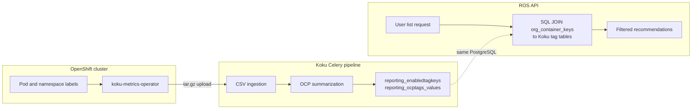

# Tag Filtering — Internal Notes

> **The contract lives on the public site.** Filter syntax, supported endpoints,
> configuration defaults, RBAC semantics, caveats, tag lifecycle, and the push-sync /
> batching contract are in
> [`docs-site/features/tag-filtering.md`](../../docs-site/features/tag-filtering.md).
> Do not restate them here — edit the public page, then check this file for anything
> that contradicts it.
>
> **Operations** (endpoints, triggers, payload, full replace, storage) are in
> [`tag-sync.md`](../operations/tag-sync.md). **Push authentication** is in
> [`tag-sync-auth.md`](../operations/tag-sync-auth.md).
>
> This page keeps only what has no public counterpart: the dual-path comparison, the
> db-mode query path, per-endpoint implementation notes, and the deferred-work list. It is
> a **stub pair** — see `docs/agents/docs-site-sync.md`.

**Why this page is a stub:** until 2026-11-06 this file carried a second full copy of the
tag contract — filter syntax, supported endpoints, RBAC, caveats, lifecycle, and env
defaults already stated on the public page — plus a third copy of the operations section
that also lives in [`tag-sync.md`](../operations/tag-sync.md) and a fourth copy of the
environment tables that live in [`docs-site/configuration.md`](../../docs-site/configuration.md).
The duplication was removed in the docs dedup pass (2026-11-06); the full prior content is
preserved in git history (through commit `ec4b5500`).

**Rule for agents:** contract facts (syntax, endpoints, defaults, lifecycle, RBAC) go to
the docs-site page; push-sync operations go to [`tag-sync.md`](../operations/tag-sync.md)
and [`tag-sync-auth.md`](../operations/tag-sync-auth.md); do not restore duplicated
content here. The pair stays listed in
[docs-site-sync.md](../agents/docs-site-sync.md) so `make docs-sync-check` keeps both
files present.

## Design notes

- **No direct operator → ROS tag path.** koku-metrics-operator collects labels into CSVs;
  Koku is the authority on which keys are enabled, and ROS only reads what Koku resolved.
- **Push path (`api`):** summarization or a Settings mutation → `schedule_ros_tag_sync` →
  Celery `sync_ros_ocp_tags` → payload from the label summaries → `POST /internal/tags/sync`
  with a ServiceAccount bearer token → TokenReview → full-replace transaction. Sequence,
  triggers, and payload fields are in [tag-sync.md](../operations/tag-sync.md).
- **db path (`db`):** no sync, no inter-service auth — list queries JOIN Koku tables. The
  cost is coupling to Koku's schema (below).

## Dual-path comparison

| Dimension | On-Prem (`db`) | SaaS (`api`) |
|-----------|----------------|--------------|
| **Database topology** | Shared PostgreSQL | Separate Koku and ROS databases |
| **Tag data location** | Koku `reporting_ocptags_values` | ROS `org_container_keys.resolved_tags` |
| **Sync mechanism** | None (live SQL JOIN) | HTTP POST full-replace |
| **Latency to new tags** | After next Koku summarization | After summarization + successful push |
| **Worst-case staleness** | Summarization schedule only | Up to ~6h if pushes fail |
| **Inter-service auth** | Not required | Kubernetes ServiceAccount TokenReview |
| **Koku config required** | None for tag sync | `ROS_TAGS_ENABLED=true`, `ROS_TAGS_SOURCE=api`, `ROS_OCP_BACKEND_URL` |
| **ROS push endpoints** | `POST /internal/tags/sync` returns 404; `GET /internal/tags/status` stays available and reports `source: "db"` | Active when `ROS_TAGS_ENABLED=true` |
| **Failure mode (Koku down)** | ROS cannot read fresh tags | Last successful sync retained |
| **Failure mode (network)** | N/A | Eventual consistency; periodic retry |
| **Operational complexity** | Lower (one DB) | Higher (auth, monitoring, Celery) |
| **Pod restart impact** | None (stateless reads) | None (tags in PostgreSQL) |

## On-Prem (Shared Database, Advanced — `ROS_TAGS_SOURCE=db`)

> **Note:** The cost-onprem Helm chart defaults to `tagsSource: api` (Koku push sync).
> This section describes the advanced shared-database mode for operators who set
> `ROS_TAGS_SOURCE=db` explicitly.

ROS does not copy tag data into its own tables for filtering. List queries **JOIN** ROS
container rows to Koku tenant tag summary tables at query time.



**Request path:**

```
User Request
  → ROS API (identity/RBAC)
  → Parse filter[tag:key]=value
  → Step 1: resolve matching containers from org_container_keys
            WHERE EXISTS (
              SELECT 1 FROM org{org_id}.reporting_ocptags_values tv,
                   unnest(tv.cluster_ids, tv.namespaces) AS t(cluster_id, namespace)
              WHERE tv.key = :key AND tv.value IN (:values)
                AND t.cluster_id = ock.cluster_uuid::text
                AND t.namespace = ock.namespace
            )
  → Step 2: fetch recommendations for those container keys
  → Response
```

**Schema convention:** Koku tenant schemas are named `org{org_id}` where `org_id` is
the bare numeric ID from the identity header (e.g. `1234567` → schema `org1234567`).
ROS derives this with the same rule — never pass `org1234567` as the org_id in API
payloads or env vars.

**Tables queried (Koku tenant schema):**

| Table | Purpose |
|-------|---------|
| `reporting_enabledtagkeys` | Enabled OCP tag keys — read by the tag catalog (`internal/tags/db_provider.go`) and the startup probe. **Not** consulted by the filter JOIN |
| `reporting_ocptags_values` | Distinct `(key, value)` pairs with parallel `cluster_ids[]` and `namespaces[]` arrays linking tags to cluster/namespace scope |

**Implementation:** [`internal/tags/db_provider.go`](../../internal/tags/db_provider.go),
[`internal/model/tag_filters.go`](../../internal/model/tag_filters.go) (`applyDBTagFiltersToKeys`).

**Properties:**

- **Zero sync latency** — tags are as fresh as the last Koku summarization; no HTTP push step.
- **No inter-service auth** — ROS reads PostgreSQL directly; no ServiceAccount tokens or push endpoints.
- **No Koku-side tag sync config** — Koku Celery push tasks are no-ops when `ROS_TAGS_SOURCE=db`.
- **Single point of dependency** — ROS list latency includes JOIN cost against Koku tables (indexed; see [query performance](../operations/query-performance.md)).

The coupling risk and startup probe are documented publicly under
[Caveats and operational risks](../../docs-site/features/tag-filtering.md#caveats-and-operational-risks).

## Per-endpoint tag application

Implementation notes for the endpoints the public page lists — how the tag predicate reaches
each result shape. Public lists *which* endpoints support tags; this table records *how*.

| Endpoint | Implementation note |
|----------|---------------------|
| Container list | Two-step query via `org_container_keys` (api) or the db JOIN |
| Container history | Same tag resolution as the container list |
| Namespace | Namespace-scoped tags applied natively |
| Node utilization | A node is included when **any** namespace on that node matches |
| PVC | Namespace-scoped |
| GPU (MIG / time-slicing lists) | Container-level workloads |
| VM | Namespace-scoped |
| Resource quota | Per-namespace quota rows |
| Cluster resource quota | Matches when **any** namespace in the CRQ scope matches |
| Snapshots (`/snapshots`, `/snapshots/summary`) | Not supported — no tag predicate |
| Per-resource detail / per-resource history | Not supported — fleet history only |

## Scalability

| Dimension | On-Prem | SaaS |
|-----------|---------|------|
| Thousands of orgs | JOIN per request; Koku tables indexed | Periodic task fans out one Celery job per tenant |
| ~200 enabled tags | EXISTS subquery per filter key | JSONB `@>` / `->>` on `resolved_tags` |
| Large namespace counts | `reporting_ocptags_values` unnest join | Batch UPDATE by `(org_id, cluster_uuid, namespace)` in one transaction |

The push payload is built from label-summary rows — roughly keys × namespaces × nodes per
report period inside the window. The query selects only the columns the payload needs, but
the row count is not small on a large tenant; payload size and sync duration at scale have
**not been measured**. Next step if sync duration becomes a concern: a synthetic large-tenant
measurement, not a narrower window (#770 fixed the opposite).

## Known gaps and deferred work

| Item | Where it stands |
|------|-----------------|
| One value per tag key | #814 — `resolved_tags` stores a single value; the payload picks the alphabetically first |
| db-mode cluster coverage | #815 — `reporting_ocptags_values` arrays are a per-run last-writer snapshot |
| `group_by[tag:key]` on list/history | Not supported; would restructure flat list responses into per-tag buckets (pagination, sorting, RBAC, OpenAPI). Medium effort per resource family; `savings-summary` covers the fleet case |
| Tag display in responses | Filter-only today; list/detail JSON carries no `labels`/`tags` |
| mTLS for SaaS push | Planned hardening; TokenReview retained during migration — see [tag-sync-auth.md](../operations/tag-sync-auth.md) |
| Pod-level tag resolution | Requires per-pod label storage on both sides; out of scope |
| Webhook / instant sync | Would reduce reliance on the 6-hour safety-net; not designed |
| Tag-based cost allocation | Correlate ROS savings with Koku tag breakdown reports; not started |
| Cross-provider tag unification | Align AWS/Azure/GCP tag keys with OCP for hybrid dashboards; not started |

## Related documentation

- [Tag sync operations](../operations/tag-sync.md)
- [Tag sync authentication](../operations/tag-sync-auth.md)
- [Configuration](../operations/configuration.md)
- [Public docs: Tag Filtering](../../docs-site/features/tag-filtering.md)
- [Koku ROS integration](../../../koku/docs/architecture/ros-ocp-integration.md)
